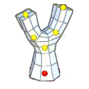
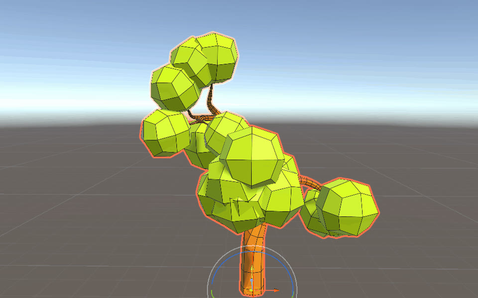
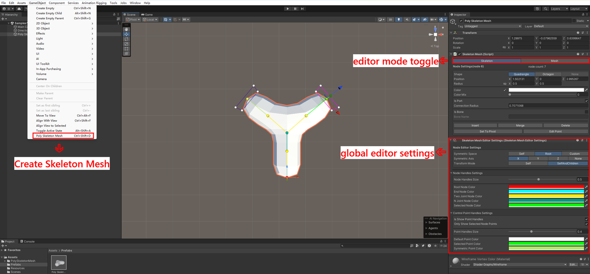
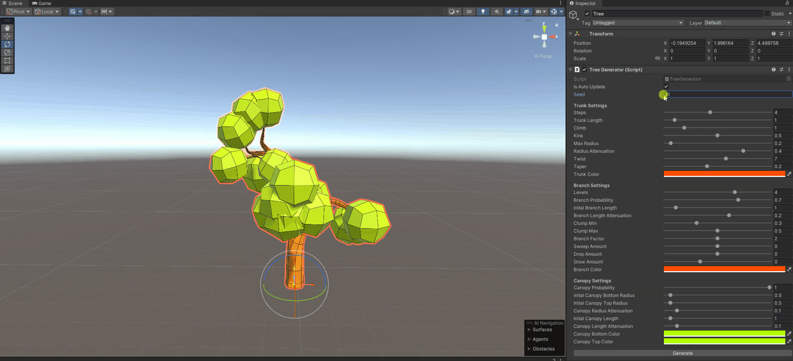
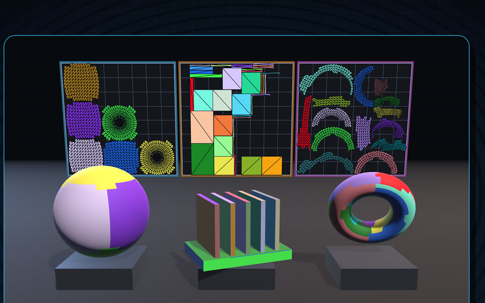
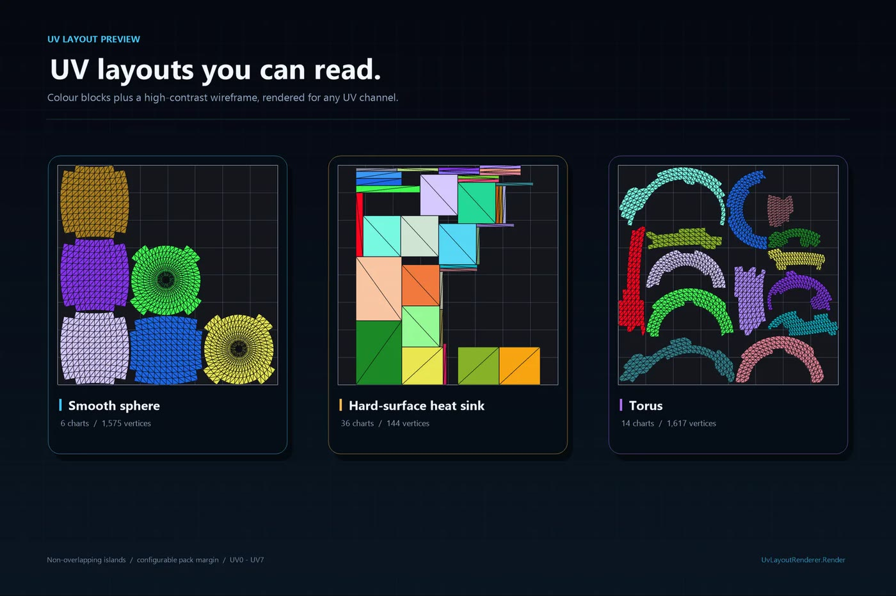
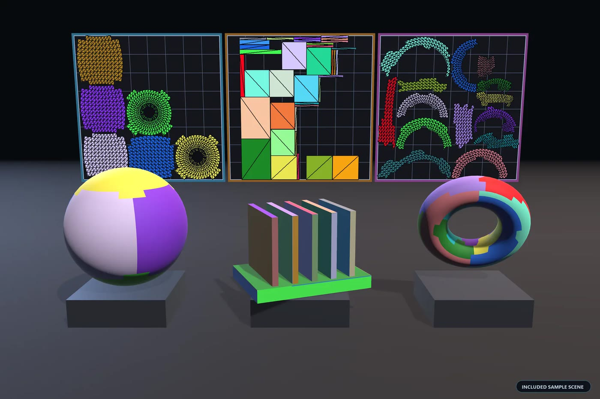

  

<h1 align="center">Yuan Qu Cool</h1>

  <b>Focused Unity packages for procedural 3D.</b> 
  Editor tools and runtime APIs that take the busywork out of making 3D content.

  <a href="https://yuanqucool.github.io/"><b>Documentation</b></a> &nbsp;·&nbsp;
  <a href="https://www.youtube.com/@YuanQuCool">YouTube</a> &nbsp;·&nbsp;
  <a href="mailto:yuanqucool@gmail.com">yuanqucool@gmail.com</a>

---

## Poly Skeleton Mesh

**Build low-poly meshes from a skeleton of nodes.**
Shape the silhouette by placing nodes and setting their radius and cross-section; the tool
generates the hull between them. Spliced together, a few skeleton meshes become a whole
creature, a tree or a prop — then export a prefab and drop it straight into your scene.

- **Node-tree modeling** — drag handles in the scene view to move, rotate, scale, insert, split
  and merge nodes, with symmetry along X, Y or Z.
- **Automatic splicing** — ports connect by proximity and the hull bridges both meshes, flipped
  parts included, so limbs and branches join without modelling.
- **Bone controllers** — bind a `Transform` to any node and deform the locked mesh like a skinned
  rig. Export generates the bone hierarchy and bind poses for you.
- **Prefab export** — mesh embedded as a sub-asset, optional lightmap UVs, a ready prefab with
  `MeshRenderer` or `SkinnedMeshRenderer`.
- **Runtime API** — build, edit, connect and export skeletons from code. GPU render path with an
  automatic CPU fallback.

| In the scene view | Procedural samples |
| :---: | :---: |
|  |  |

The package ships with five sample scenes: a showcase, a tree generator with click-to-plant
growth, a runtime monster builder with IK and JSON save data, and a mesh-to-wireframe converter.

**Unity 6+** &nbsp;·&nbsp; [Documentation](https://yuanqucool.github.io/plugins/poly-skeleton-mesh/) &nbsp;·&nbsp; [Asset Store](https://assetstore.unity.com/packages/slug/313559) &nbsp;·&nbsp; [YouTube demos](https://www.youtube.com/@YuanQuCool)

---

## Auto UV

**Non-overlapping UVs at runtime, in the editor, anywhere.**
A pure C# UV unwrapper that generates an additional UV set for any mesh — the lightmap UV2 you
need for baking, or any custom channel from UV0 to UV7.

- **Any UV channel** — writes `mesh.uv` through `mesh.uv7`; lightmap UV2 by default.
- **No overlaps** — charts are cut apart and flattened individually, then packed with a
  configurable `packMargin`, so no two islands overlap.
- **Low stretch** — normal-cone charting, LSCM flattening with ARAP refinement; round parts such
  as spheres and capsules are split into regular axial charts.
- **Runtime ready** — no `UnityEditor` references, so the same call works in a player build, in
  the editor window and inside frame-spread coroutines with progress reporting.
- **Deterministic and non-destructive** — repeated runs are bit-identical, and `Generate` never
  touches the source mesh.
- **Layout preview** — `UvLayoutRenderer` renders any channel into a square texture, optionally
  as colour blocks with one colour per island.

| Readable layouts | Included sample scene |
| :---: | :---: |
|  |  |

Every vertex channel is preserved — normals, tangents, vertex colours, UV0–UV7, skin weights,
BindShapes, BlendShapes and submeshes — and the included sample scene unwraps three procedural
meshes at runtime, with live chart and coverage statistics.

**Unity 6+** &nbsp;·&nbsp; [Documentation](https://yuanqucool.github.io/plugins/auto-uv/) &nbsp;·&nbsp; *Asset Store listing in review*

---

## About this repository

This is the static site behind **<https://yuanqucool.github.io/>** — the manuals, sample media and
install notes for every package. Plain HTML, CSS and JavaScript, no build step, published by
GitHub Pages from `main`.

- Plugin registry (cards, pagers, store links): [`js/plugins.js`](js/plugins.js)
- Design system: [`css/site.css`](css/site.css) · behaviour: [`js/site.js`](js/site.js)
- **Maintenance guide** — adding a plugin, writing docs, optimising media: [`docs/site-guide.md`](docs/site-guide.md)

Found a problem in the documentation? [Open an issue](https://github.com/yuanqucool/yuanqucool.github.io/issues) or write to
[yuanqucool@gmail.com](mailto:yuanqucool@gmail.com).

© Yuan Qu Cool · Unity is a trademark of Unity Technologies.

